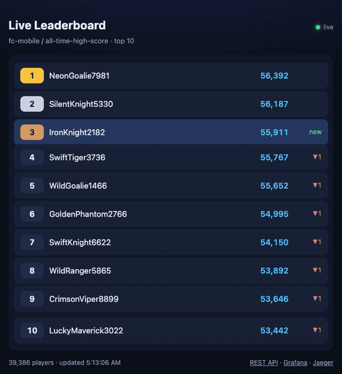
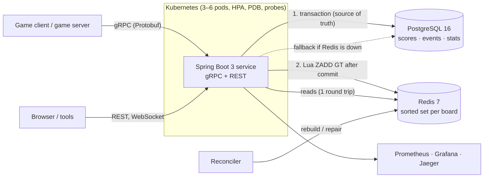
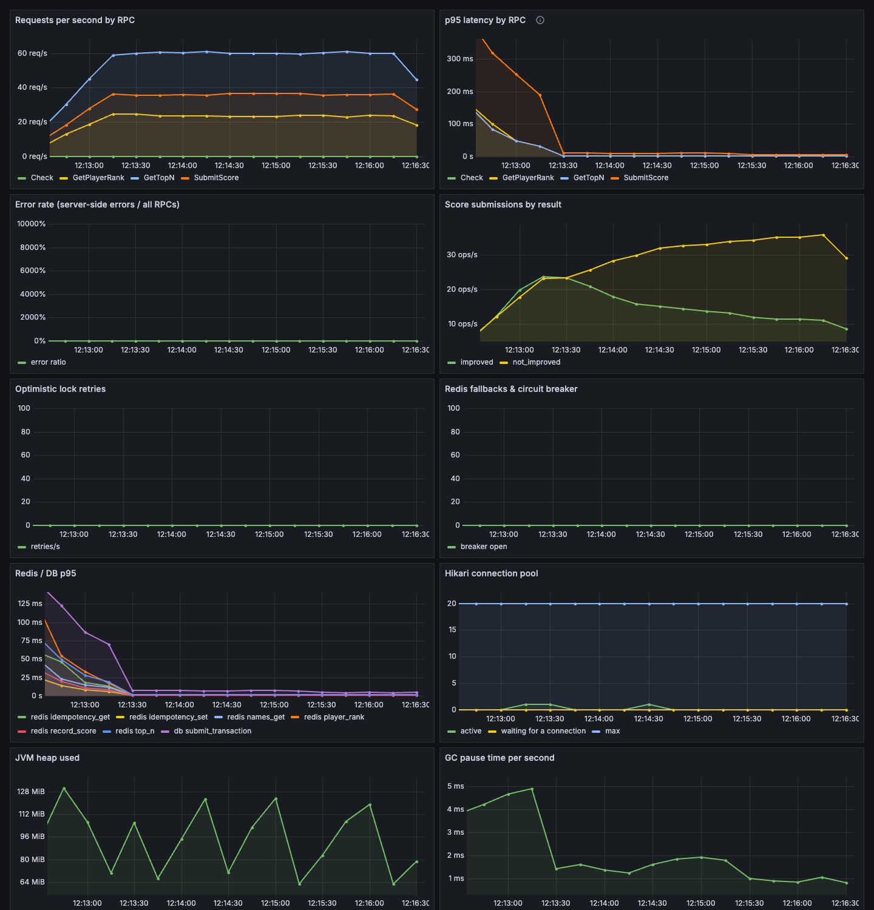
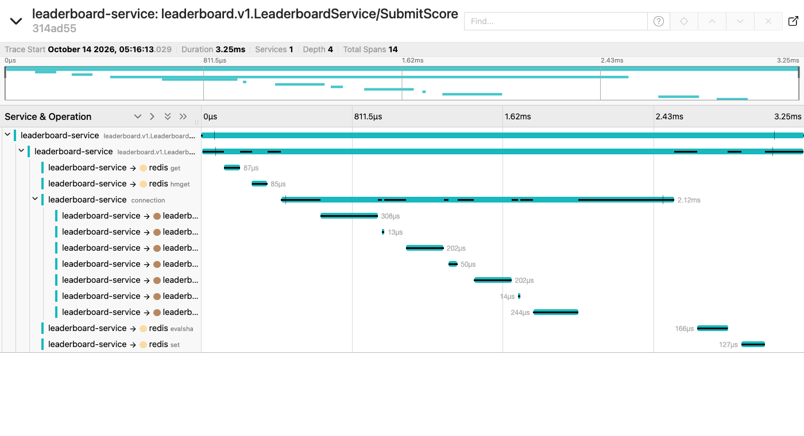

# Game Stats & Leaderboard Service

**Game Stats & Leaderboard Service: a gameplay-services-style backend that captures player stats and powers real-time global, friends, and seasonal leaderboards.**

[](https://github.com/asmipahwa/leaderboard-service/actions/workflows/ci.yml)
-91%25-brightgreen)




*The demo page (`/demo`) over a WebSocket while a bot submits scores: ranks reshuffle live, at most 4 updates a second.*

## What players get

- **Global, seasonal, weekly and daily boards.** Weekly and daily boards reset on schedule (UTC, ISO weeks), and past periods stay viewable.
- **"Where do I rank, and who's around me?"** Your rank, percentile, and the players just above and below you.
- **Friends leaderboard.** You vs. your friends, ranked among yourselves.
- **Your stats and achievements.** Matches, wins, win rate, best score, match history, and achievements that unlock once.
- **Live updates.** A gRPC server stream and a WebSocket push the top 10 as it changes.
- **Your score never disappears.** Retries can't double-count (idempotency keys), races can't lose an update (optimistic locking), and a cache failure can't lose data (Postgres is the source of truth).

## Results

All numbers come from saved runs in [`docs/results/`](docs/results). Setup and the full optimization log are in [PERFORMANCE.md](docs/PERFORMANCE.md).

| Metric | Result | How measured |
|---|---|---|
| GetTopN(100) **p95** | **3 ms** (p50 1 ms, p99 5 ms; server-side p95 1.68 ms) | Gatling `ReadHeavySimulation`: 300 req/s for 2 min on a **100k-player** board, warmed JVM, tracing on ([report](docs/results/2026-10-14-readheavy-FINAL/index.html)) |
| Concurrent score updates | **6,000** SubmitScore in **3 bursts of 2,000 simultaneous** calls, **0 lost writes**, 0 failed | Gatling `ConcurrentWriteSimulation` + `WriteVerifier` checking Postgres and Redis ([report](docs/results/2026-10-14-concurrent-write-FINAL/index.html), [verification](docs/results/2026-10-14-concurrent-write-FINAL/write-verification.txt)); also `ConcurrentSubmitIT` (2,500 at once, 0 lost) |
| Optimistic locking | 21 conflicts detected and retried in that run, 0 gave up | `leaderboard_optimistic_lock_retries_total` |
| Failed requests during a rolling update | **0 of 9,000** while every pod was replaced | Gatling `RollingUpdateSimulation` during `kubectl rollout restart` on kind ([report](docs/results/2026-10-14-rolling-update-kind-FINAL/index.html), [transcript](docs/results/2026-10-14-rolling-update-kind-FINAL/rollout-transcript.txt)) |
| Mixed traffic, 5 min @ 200 req/s | 60,000 requests, 0 errors, p95 5 ms | Gatling `MixedSimulation` ([report](docs/results/2026-10-14-mixed-5min/index.html)) |
| Test coverage (service + cache) | **91% lines** (gate: 80%, enforced in CI) | JaCoCo, unit + integration tests |

Biggest win from profiling: **GetTopN p95 669 ms → 4 ms**, by pooling Redis connections. Every read had been opening a new TCP connection ([details](docs/PERFORMANCE.md#1-pool-redis-connections-gettopn-p95-669-ms--4-ms)).

## Architecture



**Write path:**
1. Idempotency check.
2. One Postgres transaction: event, best score with a `@Version` check, stats, achievements.
3. **After commit**, one Lua call does `ZADD GT` and returns the new rank.

**Read path:** one Lua call against the Redis sorted set returns the page, names and ranks. Postgres is never touched on the hot path. Full write-up: [DESIGN.md](docs/DESIGN.md).

## Quickstart

```bash
make up && make seed && open http://localhost:8080/demo
make demo-bot            # in another terminal: watch the board move
```

Requires Docker. `make seed` loads 3 games, 8 leaderboards, 100k players and 500k score events in about a minute. Also running:
- Swagger UI: http://localhost:8080/swagger-ui.html
- Grafana: http://localhost:3000
- Jaeger: http://localhost:16686

`make help` lists everything.

## API examples

gRPC is the primary API ([`leaderboard.proto`](src/main/proto/leaderboard/v1/leaderboard.proto); reflection is on, so `grpcurl` needs no proto file):

```console
$ grpcurl -plaintext -d '{"leaderboard":{"game_id":"fc-mobile","leaderboard_id":"season-1-high-score"},"n":3}' \
    localhost:9090 leaderboard.v1.LeaderboardService/GetTopN
{
  "entries": [
    { "rank": "1", "player_id": "5a127460-8815-44f8-9abf-33d4eb0e149c", "display_name": "NeonPhantom158", "score": "64443" },
    { "rank": "2", "player_id": "b55b1d26-7d90-4aca-8700-af60497abb01", "display_name": "NeonBlaze569", "score": "56898" },
    { "rank": "3", "player_id": "bad3c25c-e272-42cb-ad5b-5864f44d52cb", "display_name": "TurboPanda7972", "score": "51425" }
  ],
  "total_players": "100000",
  "as_of": "2026-10-14T09:22:07.477982Z"
}

$ grpcurl -plaintext -d '{"leaderboard":{"game_id":"fc-mobile","leaderboard_id":"season-1-high-score"},
    "player_id":"aa3aef52-a354-4707-96b7-260b66b2a3c0","score":70000,"idempotency_key":"match-7f3c","win":true}' \
    localhost:9090 leaderboard.v1.LeaderboardService/SubmitScore
{ "improved": true, "best_score": "70000", "rank": "1", "previous_rank": "49996" }

$ grpcurl -plaintext -d '{"leaderboard":{"game_id":"fc-mobile","leaderboard_id":"season-1-high-score"},
    "player_id":"aa3aef52-a354-4707-96b7-260b66b2a3c0","around":1}' \
    localhost:9090 leaderboard.v1.LeaderboardService/GetPlayerRank
```

REST (same services):

```bash
curl "localhost:8080/api/v1/games/fc-mobile/leaderboards/season-1-high-score/top?n=10"
curl "localhost:8080/api/v1/games/fc-mobile/leaderboards/season-1-high-score/players/{playerId}/rank?around=2"
curl "localhost:8080/api/v1/games/fc-mobile/players/{playerId}/stats"
curl -X POST localhost:8080/api/v1/games/fc-mobile/leaderboards/season-1-high-score/scores \
  -H 'Content-Type: application/json' -d '{"playerId":"...","score":4200,"idempotencyKey":"match-123","win":true}'
```

RPCs: `SubmitScore`, `BatchSubmitScores`, `GetTopN`, `GetPlayerRank`, `GetFriendsLeaderboard`, `StreamTopN` (server streaming), `GetPlayerStats`, `GetScoreHistory` (paginated).

## Design decisions (short)

| Decision | Why | More |
|---|---|---|
| Redis sorted sets, not `ORDER BY` | Top N and "my rank" in O(log N), no database on the hot path | [DESIGN §4.1](docs/DESIGN.md#41-redis-sorted-sets-for-ranking-vs-sql-order-by) |
| Postgres first, Redis after commit | The source of truth wins; Redis can only lag, never lie | [§4.2](docs/DESIGN.md#42-write-order-postgres-first-then-redis) |
| `ZADD GT` in Lua | Idempotent and order-independent cache updates; rank returned atomically | [§4.2](docs/DESIGN.md#42-write-order-postgres-first-then-redis) |
| Optimistic locking (`@Version`) + retry | Conflicts are rare, so don't lock every read | [§4.3](docs/DESIGN.md#43-optimistic-locking-vs-pessimistic-vs-a-blind-upsert) |
| Idempotency keys | Mobile clients retry; a retry must never double-count | [§4.4](docs/DESIGN.md#44-idempotency-keys) |
| Rebuild lock, circuit breaker, reconciler | No cache stampede; reads survive Redis outages; drift gets repaired | [§4.5](docs/DESIGN.md#45-cache-misses-stampedes-and-failures) |
| gRPC first, thin REST | Typed contract, HTTP/2, deadlines, streaming; REST for browsers | [§4.7](docs/DESIGN.md#47-grpc-first-rest-second) |
| Period keys (`2026-W42`) | Resets without deletes; old periods stay readable | [§3](docs/DESIGN.md#3-data-model) |
| Competition ranking (1, 2, 2, 4) | Fair ties, identical in Redis and the SQL fallback | [§4.6](docs/DESIGN.md#46-ties-and-ranks) |

## Scaling to EA scale

How I'd go from here to tens of millions of players: approximate ranks for the long tail (score buckets / t-digest), sharding hot event boards, Kafka for score events, Redis Cluster hash tags, read replicas and multi-region boards. See [DESIGN §6](docs/DESIGN.md#6-scaling-to-ea-scale-what-id-change).

## Testing

`make test` (unit) and `make it` (integration against real Postgres 16 and Redis 7 via Testcontainers). Highlights:
- **`ConcurrentSubmitIT`:** 2,500 submissions at once, 0 lost writes, lock retries > 0.
- **`IdempotencyIT`:** sequential, concurrent and Redis-forgot-the-key duplicates are each counted once.
- **`RedisLossRecoveryIT`:** `FLUSHALL`, then an identical top 100 rebuilt from Postgres.
- **`RedisDownFallbackIT`:** Redis paused; reads and writes keep working and the breaker opens.
- **`ApiEvolutionIT`:** a client built from the frozen original proto still works.
- Also: `PeriodLeaderboardsIT`, `ReconcilerIT`, `AchievementsIT`, `RestApiIT`, `SubmitAndQueryIT` (ties at page boundaries, around-me, streaming).

## Observability

Micrometer → Prometheus → [Grafana dashboard](observability/grafana/dashboards/leaderboard.json), OpenTelemetry → Jaeger, JSON logs carrying `traceId`, and alert rules. [OBSERVABILITY.md](docs/OBSERVABILITY.md) includes a real debugging walkthrough (injected slow query → metric → trace → log).




## Kubernetes

`make kind-up deploy seed-k8s rollout-demo` covers:
- 3 replicas, `maxUnavailable: 0`;
- startup, readiness and liveness probes;
- `preStop` drain, graceful gRPC shutdown (GOAWAY);
- HPA (3–6 pods), PDB, Postgres StatefulSet, Redis and ingress.

See [K8S.md](docs/K8S.md), including what broke on the way (OOM under overload, service-link env vars, gRPC's per-connection load balancing).

## CI/CD

GitHub Actions on every push and PR:
- format check and unit tests;
- Testcontainers integration tests and the coverage gate;
- Docker build, **pushed to GHCR** from `main` (`ghcr.io/asmipahwa/leaderboard-service`);
- deploy to a **kind cluster** and call GetTopN over gRPC.

Merges to `main` go through PRs that need green CI. Sprint notes: [SPRINT_LOG.md](docs/SPRINT_LOG.md).

## What I learned

- **Measure before optimizing.** The biggest latency win (669 ms → 4 ms) was a missing connection pool I wouldn't have guessed. Two "optimizations" I expected to help turned out to be inside run-to-run noise, and I report them that way.
- **Correctness under concurrency needs proof, not reasoning.** A test that releases 2,500 writes at once caught a regression that only appeared after I added observability. Debugging it taught me about thundering herds, bulkheads and circuit-breaker windows.
- **Kubernetes zero-downtime is a chain of details:** readiness after cache warm-up, `preStop`, graceful gRPC GOAWAY, `maxUnavailable: 0`. Plus gRPC's per-connection load balancing, which an HPA alone doesn't fix.

## Docs

[DESIGN](docs/DESIGN.md) · [PERFORMANCE](docs/PERFORMANCE.md) · [OBSERVABILITY](docs/OBSERVABILITY.md) · [K8S](docs/K8S.md) · [API_EVOLUTION](docs/API_EVOLUTION.md) · [SPRINT_LOG](docs/SPRINT_LOG.md) · [INTERVIEW_NOTES](docs/INTERVIEW_NOTES.md)

## License

[MIT](LICENSE)
