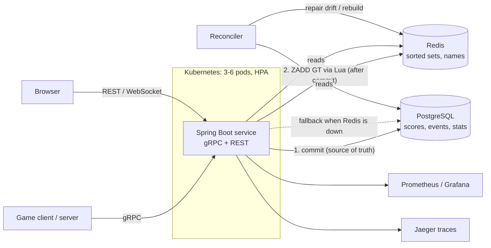

# Design: Game Stats & Leaderboard Service

| | |
|---|---|
| Author | Asmi Pahwa |
| Status | Implemented |
| Scope | Score submission, global / seasonal / friends leaderboards, player stats, achievements |

## 1. Problem

Games need to:
1. **record** match results reliably, even when mobile clients retry over bad networks;
2. **rank** players instantly ("top 100", "where am I and who's around me", "me vs. my friends");
3. **track progress** (matches, wins, best score, achievements), with boards that **reset** daily, weekly or per season.

Reads vastly outnumber writes, and writes arrive in **bursts**, because thousands of matches end at the same moment.

### Goals
- GetTopN(100) p95 < 10 ms on a 100k-player board.
- No lost or double-counted writes under 2,000+ concurrent submissions.
- Leaderboards stay readable if the cache fails, and deploys cause no downtime.

### Non-goals
Identity/auth (another platform service), anti-cheat (a hook point only), cross-region replication.

## 2. Architecture

**Postgres is the source of truth.** Redis holds a ranking cache that can always be rebuilt from Postgres.

## 3. Data model

See [`V1__init.sql`](../src/main/resources/db/migration/V1__init.sql).

- `scores`: **one row per player per board period** with the best score and a `version` column (optimistic locking).
- `score_events`: every submission, append-only, with a **unique `idempotency_key`**.
- `player_stats`: pre-aggregated counters, so a profile is one primary-key read.

**Periods:** a reset is just a new key: `all`, `2026-10-14`, `2026-W42` (ISO week, UTC), `S1`. Nothing is deleted when a week ends. The old week is still queryable, and its Redis set expires 7 days after the period ends.

## 4. Key decisions

### 4.1 Redis sorted sets for ranking (vs. SQL `ORDER BY`)
- A sorted set keeps members ordered by score. Top N is `ZREVRANGE` (O(log N + M)) and my rank is `ZREVRANK`/`ZCOUNT` (O(log N)).
- In SQL, "rank of player X" means counting every better row. Even with the `(board, period, best_score DESC)` index, that is O(rank), plus a database round trip per read.
- One sorted set per board period: `lb:{game}:{board}:{period}`, member = player id, score = best score. **ASC boards** (fastest lap) store the negated score, so every board uses the same "higher is better" commands.
- Display names live in one hash (`player:names`), so a top-100 read never joins Postgres.
- A whole page (state, size, entries, names, first-entry rank) is read in **one Lua call** ([`top_n.lua`](../src/main/resources/scripts/top_n.lua)). "My rank + neighbours" is also one call ([`player_rank.lua`](../src/main/resources/scripts/player_rank.lua)), down from 7 round trips.

*Alternative considered:* Postgres only, with window functions. That's simpler, but every read hits the database and ranking deep in a big board stays expensive. It's kept as the **fallback path** for when Redis is down.

### 4.2 Write order: Postgres first, then Redis
1. Validate, then pass the bulkhead (at most 64 submissions run at once; the rest queue).
2. Idempotency fast path: Redis `idem:{key}` returns the stored result if this exact request was already processed.
3. **One Postgres transaction:** check `score_events` for the key → read the `scores` row → insert or `offer()` the new score → insert the event → upsert stats → unlock achievements → commit.
4. **After commit,** a Lua script does `ZADD key GT CH score player` and returns the old and new rank atomically.
5. Mark the board changed (live WebSocket and gRPC streams are pushed at most 4 times a second).

**Why this order?** If Redis were written first and the transaction then failed, players would see a rank for a score that doesn't exist. With Postgres first, the worst case is that Redis *lags*. The write path then marks the board dirty, and the **reconciler** rebuilds it.

**Why `ZADD GT` makes the cache update safe:** GT only ever raises a member's score. Applying the same update twice changes nothing (idempotent), and two updates applied in either order end at the same max (order-independent). A retried request, a race between two pods, or a rebuild running alongside live writes can never make Redis go *backwards*.

### 4.3 Optimistic locking (vs. pessimistic, vs. a blind upsert)
- The best-score row carries `@Version`. Hibernate's `UPDATE ... SET best_score=?, version=version+1 WHERE ... AND version=?` fails if another transaction changed the row since we read it. We then **retry the whole transaction** with fresh data, up to 5 times with full-jitter exponential backoff (5–80 ms), and return `ABORTED` after that.
- **Why not pessimistic (`SELECT ... FOR UPDATE`)?** Conflicts are rare: one only happens when two requests for the *same player* both beat the stored best at the same moment. Most submissions don't improve anything and never write the row. Locking on every read would serialize all traffic for a player to protect against a rare case.
- **Why not `INSERT ... ON CONFLICT DO UPDATE SET best = GREATEST(...)`?** It's correct for the number itself, and it's how the **stats counters** work (`matches = matches + 1` can't conflict). But the best score needs application logic that depends on the previous value: ASC vs DESC, the `improved` flag, the previous rank, achievements, and a future anti-cheat check ("is this jump plausible?"). Optimistic locking keeps that logic in Java while staying safe.
- **Measured:** 2,500 simultaneous submissions on 50 players → retries > 0 and 0 lost writes (`ConcurrentSubmitIT`). Gatling 3 × 2,000 bursts → 21 retries, 0 lost writes.

### 4.4 Idempotency keys
- The client generates one UUID per match result and reuses it on every retry.
- **Fast path:** Redis `SET NX` with a 24 h TTL holds the result.
- **Guarantee:** `UNIQUE(score_events.idempotency_key)`. If two copies race past the fast path, one insert fails, the transaction retries, sees the stored event, and returns it as a duplicate. Proven by `IdempotencyIT`: 10 sequential copies, 10 concurrent copies, and a copy arriving after Redis forgot the key all produce one event and one counted match.

### 4.5 Cache misses, stampedes and failures
- **Cold board** (deploy, Redis restart, new period): the first reader takes `SET lock:rebuild:{board} NX PX`, streams the board from Postgres with keyset pagination, and loads it with pipelined `ZADD GT`. Other readers wait for the `ready` marker instead of all hitting Postgres. That prevents a **cache stampede**.
- **Pods warm the current boards before reporting ready** (`CacheWarmer` runs before readiness), so a new pod never serves a cold board.
- **Redis down:** every Redis call goes through a circuit breaker (`RedisGuard`: 500 ms timeouts, 10 s time-based window, opens at 50% failures over ≥ 100 calls). Reads fall back to equivalent SQL (rank via window functions), and writes still commit (ranked by SQL) and mark the board dirty. Proven by `RedisDownFallbackIT`, which pauses the Redis container.
- **Drift:** the reconciler samples 200 players per board every minute and repairs any Redis score that is missing or low (`leaderboard_drift_fixed_total`).

### 4.6 Ties and ranks
**Standard competition ranking:** 1, 2, 2, 4. Rank = 1 + number of players with a strictly better score (`ZCOUNT (score +inf`). Ties are listed by player id descending, which is Redis's order for equal scores, and the SQL fallback uses the same order, so both paths return identical pages (`RedisLossRecoveryIT`). A page that starts in the middle of a tie still shows the tied rank (the Lua script counts better scores for the first entry).

### 4.7 gRPC first, REST second
- gRPC/Protobuf is the contract for game clients and servers: a typed schema, compact binary, HTTP/2 multiplexing, deadlines, status codes and server streaming (`StreamTopN`).
- A thin REST facade (and a WebSocket mirror of `StreamTopN`) serves browsers, tools and the demo page.
- Both call the same services.
- Error mapping: `INVALID_ARGUMENT`, `NOT_FOUND`, `ABORTED` (retry), `UNAVAILABLE` (back off and retry), `INTERNAL`.
- Evolution rules: [API_EVOLUTION.md](API_EVOLUTION.md).

### 4.8 Bursts: bulkhead + virtual threads
- A burst of 2,000 simultaneous submissions used to create 2,000 OS threads that all hit Redis at once, before Postgres (20 connections) could take them. A few Redis calls timed out and tripped the breaker.
- Now gRPC handlers run on **virtual threads**, and a **fair semaphore** lets 64 submissions run at once. The rest queue (up to 9 s, then `UNAVAILABLE` → the client retries with the same key).
- gRPC also caps in-flight calls per connection (256) for backpressure on reads.

## 5. Observability
Metrics, traces and JSON logs with trace ids. See [OBSERVABILITY.md](OBSERVABILITY.md) and its debugging walkthrough.

## 6. Scaling to EA scale (what I'd change)

| Pressure | Approach |
|---|---|
| **Huge boards (50M players)** | Keep exact ranks for the top (e.g. 100k) in a sorted set. For the long tail, use **score buckets** (a counter per score range → approximate rank) or a quantile sketch (t-digest), and show "top 3%" instead of "#4,211,337". Exact ranks deep in the tail matter to no one |
| **Hot key** (a celebrity event board) | Shard the board's writes across N sub-sets (`lb:...:{shard}`) and merge the top N on read, or put a short-lived in-process cache on the hot top-100 read. Read replicas for Redis |
| **Write volume** | Publish score events to **Kafka**. Rank updates and stats become consumers, and the API acks after the durable append. Partition by player id so per-player ordering is kept, which also removes most lock conflicts |
| **Redis Cluster** | Use hash tags (`lb:{game:board:period}`) so a board's set, meta and version keys live on the same slot for the Lua scripts. Names would move to per-board or per-shard hashes |
| **Postgres** | Partition `score_events` by time; read replicas for history and stats; archive old periods |
| **Multi-region** | Regional leaderboards are local. A global board merges regional top-Ns, or writes go to a home region |
| **Anti-cheat** | A validation hook in the write transaction (we already have the previous best): reject impossible jumps, rate-limit per player, flag for review |

## 7. Risks and trade-offs
- Redis can lag Postgres for a moment after an outage (bounded by the reconciler interval, or immediate for dirty boards when Redis returns).
- Friends lists are cached for an hour (they belong to another service), so a new friend appears with a delay.
- Live pushes are per pod. Across pods this would use Redis pub/sub or Kafka.
- The weakest part is single-node Postgres write throughput during huge bursts (about 1,500 tx/s on a laptop). Kafka plus batching would be the next step.
