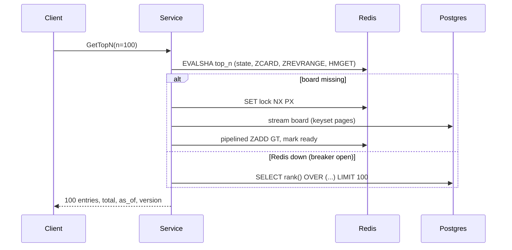

# Interview notes

My own study guide for explaining this project out loud. Plain English first, details second.

## 1. Pitches

### 30 seconds
> "I built a leaderboard and player-stats backend like the ones EA's Stats & Leaderboards team runs. Game clients call it over **gRPC**. **Postgres** is the source of truth for every score, and **Redis sorted sets** serve the rankings, so a top-100 query is **3 ms at p95** on a 100,000-player board. Writes use **optimistic locking** and **idempotency keys**: I fired 2,000 simultaneous score submissions at it three times with **Gatling** and verified **zero lost writes** in both Postgres and Redis. It runs on **Kubernetes** with health probes and graceful shutdown, and I proved a rolling restart drops **zero of 9,000** requests."

### 2 minutes (add these after the 30 s version)
1. **Write path:** a score goes into one Postgres transaction (event row, best score with a version check, stats, achievements). Only **after commit** does a Lua script update Redis with `ZADD GT`. If Redis is down, nothing is lost; a reconciler repairs Redis later.
2. **Read path:** one Lua call returns the page, the names and the ranks. Postgres is never touched. If Redis fails, a circuit breaker switches reads to equivalent SQL.
3. **Performance story:** my first benchmark had p95 at **669 ms**. Profiling showed every read opened a new Redis TCP connection, because Spring pipelines need a dedicated connection and I had no pool. Adding a pool took it to **4 ms**. I also cut GetPlayerRank from 7 Redis round trips to 1 (server p95 4.07 → 1.29 ms).
4. **Correctness story:** after I added observability, my 2,500-concurrent-writes test started failing *sometimes*. Postgres was always right, but Redis fell behind. I ruled out each library one at a time and re-ran the old commit to confirm it was a regression. Root cause: a thundering herd. 2,500 requests hit Redis at once and tripped the circuit breaker. I fixed it with a bulkhead, virtual threads and a time-based breaker window.
5. **Kubernetes:** zero downtime comes from `maxUnavailable: 0`, readiness only after the cache is warm, a `preStop` sleep, and graceful gRPC shutdown (GOAWAY). The HPA scaled 3 → 6 pods. That also taught me gRPC load-balances per connection on Kubernetes, so new pods can sit idle.

## 2. Request flows

### SubmitScore
1. The gRPC call arrives on a virtual thread. Interceptors set a deadline, start a trace span and time the call.
2. Validate the input (ids, UUID, score 0..2^53, idempotency key).
3. **Bulkhead:** wait for one of 64 slots (fair queue; after 9 s, return `UNAVAILABLE`).
4. Redis `GET idem:{key}`. If it's there, return the stored result (a duplicate).
5. Redis `HMGET player:names`, which also confirms the player exists.
6. **Postgres transaction:**
   1. Event row for this key already exists? Return a duplicate.
   2. `SELECT` the score row with its version.
   3. No row: `INSERT`. Row exists: `offer()` compares in Java and marks the row changed only if the new score is better.
   4. `INSERT score_events` (the unique key blocks concurrent duplicates).
   5. Atomic stats upsert (`matches = matches + 1 ...`).
   6. Achievements: `INSERT ... ON CONFLICT DO NOTHING`.
   7. **Commit.** Hibernate runs `UPDATE ... WHERE version = ?`. If 0 rows match, the commit fails → retry from 6.2 (up to 5 times, with jittered backoff).
7. **After commit:** the Lua `record_score.lua` does `ZSCORE` (old rank) → `ZADD GT CH` → `INCR` version → `ZCOUNT` (new rank), all in one atomic call.
8. Redis `SET idem:{key} NX EX 86400` stores the result. The board is marked changed (live pushes ≤ 4/s).
9. Respond: improved, best, rank, previous rank, achievements.

```mermaid
sequenceDiagram
  participant C as Client
  participant S as Service
  participant R as Redis
  participant P as Postgres
  C->>S: SubmitScore(key, score)
  S->>R: GET idem:key
  S->>R: HMGET player:names
  S->>P: BEGIN; SELECT score (version v); INSERT event; UPSERT stats
  S->>P: COMMIT → UPDATE ... WHERE version = v
  alt version changed (lost race)
    S->>P: retry the whole transaction
  end
  S->>R: EVALSHA record_score (ZADD GT, ranks)
  S->>R: SET idem:key NX EX 24h
  S-->>C: improved, best, rank, previous rank
```

### GetTopN(100)
1. Resolve the board definition from an in-memory registry (sort order, reset period) and compute the current period key.
2. One `EVALSHA top_n.lua`:
   - `GET` meta (is the board fully built?);
   - `ZCARD` (total players);
   - `ZREVRANGE 0 99 WITHSCORES`;
   - `HMGET` the 100 names;
   - `ZCOUNT` for the first rank (only when offset > 0);
   - `GET` the version.
3. Assign competition ranks in Java (1, 2, 2, 4) and build the protobuf response.
4. If the board isn't built yet, take a rebuild lock and load it from Postgres, while other callers wait. If Redis is down, the circuit breaker sends the call to SQL.



## 3. Each technology: what, why, alternative

| Tech | What it is (one line) | Why here | Alternative | Why not |
|---|---|---|---|---|
| Spring Boot | Java framework that wires an app together (web, data, metrics) | Production defaults (actuator, graceful shutdown); EA's stack | Quarkus, Micronaut | Fine choices; Spring is what the team uses and what I know |
| gRPC / Protobuf | RPC over HTTP/2 with a typed, binary schema | Contract-first API for game clients; deadlines, status codes, streaming | REST + JSON | Kept as a thin facade for browsers; worse for typed, high-volume clients |
| PostgreSQL | Relational database with transactions | Durable source of truth, unique constraints, row versions | MySQL, DynamoDB | MySQL would work. DynamoDB makes rank queries and transactions harder |
| Redis sorted set | In-memory set ordered by score | O(log N) top-N and rank lookups | SQL `ORDER BY` + index | Hits the DB on every read; rank deep in the board gets expensive |
| Flyway | Versioned SQL migrations | Schema changes reviewed and applied the same way everywhere | Liquibase, Hibernate `ddl-auto` | `ddl-auto` is unsafe in prod; Liquibase is heavier |
| Testcontainers | Real Postgres/Redis in Docker for tests | Tests the real SQL, Lua and locking behaviour | H2, mocks | H2 isn't Postgres; mocks can't prove concurrency |
| Gatling | Load-testing tool with code-defined scenarios and HTML reports | Bursty and open-model load, percentile reports | k6, JMeter | Both fine; Gatling's Java DSL fits a Java team |
| Prometheus | Scrapes and stores metrics; PromQL | Percentiles across pods via histograms | Datadog, CloudWatch | Paid / cloud-specific |
| Grafana | Dashboards over metrics | One-glance health: RPS, p95, errors, retries | Kibana | Kibana is logs-first |
| OpenTelemetry + Jaeger | Distributed tracing standard + UI | See which step of a slow request took the time | Zipkin | Similar; OTel is the vendor-neutral standard |
| Docker | Packages the app and its runtime | Same artifact in dev, CI and K8s | Buildpacks | Less control over the layers |
| Kubernetes | Runs and heals containers, rolls out versions | Rolling updates, probes, autoscaling | ECS, VMs | K8s is EA's environment and the industry standard |
| GitHub Actions | CI/CD pipelines on GitHub | Tests, coverage gate, image push, kind smoke test on every push | Jenkins | Self-hosted overhead |

## 4. Big-O of the Redis operations

N = players on the board, M = entries returned.

| Command | Cost | Used for |
|---|---|---|
| `ZADD key GT CH score member` | O(log N) | Record a best score |
| `ZSCORE` / `ZMSCORE` | O(1) / O(k) | A player's score; friends' scores |
| `ZREVRANK` | O(log N) | A player's position |
| `ZCOUNT key (s +inf` | O(log N) | Competition rank = 1 + better players |
| `ZREVRANGE start stop WITHSCORES` | O(log N + M) | A page (top 100) |
| `ZCARD` | O(1) | Total players |
| `HMGET names ids…` | O(M) | Display names |
| `SET NX PX` / `GET` / `INCR` | O(1) | Locks, idempotency, version |

## 5. Likely questions, with answers

1. **What does p95 mean, and why not the average?**
   95% of requests were faster than this. Averages hide the slow tail. My baseline had a 2 ms median but a 669 ms p95: most players were fine, 1 in 20 waited ages. Players notice the tail.

2. **Why both Postgres and Redis?**
   Postgres is durable and transactional (the truth). Redis is fast at ranking (the view). Each does what it's best at.

3. **What if they disagree?**
   Postgres wins. Redis is only written after commit and only moves up (`ZADD GT`), so it can lag but never invent a score. The reconciler samples players every minute and repairs low or missing entries; a board that missed a write is rebuilt in full.

4. **What if Redis dies?**
   The circuit breaker opens. Reads use equivalent SQL (slower, still correct). Writes still commit and get a SQL rank, and the board is marked dirty. When Redis is back, a rebuild restores it. `RedisDownFallbackIT` proves it by pausing the Redis container.

5. **Optimistic vs. pessimistic locking?**
   Pessimistic locks the row when you read it (`SELECT ... FOR UPDATE`), so others wait. Optimistic doesn't lock: you check at write time whether someone changed the row (the version column). Pick optimistic when conflicts are rare, as here: a conflict needs two improving scores for the same player at the same instant. Pick pessimistic when conflicts are common and retries would be expensive.

6. **What's a version column?**
   A number that goes up on every update. The update says `WHERE version = <what I read>`. Zero rows updated means someone beat you to it, so you retry with fresh data.

7. **How many conflicts did you see?**
   In the Gatling run, 21 retries across 6,000 writes. That's low, and that's the point: most submissions don't beat the stored best, so they never write the row.

8. **What is idempotency, and why does a game client need it?**
   Doing the same operation twice has the same effect as doing it once. On a bad mobile network the response can get lost after the server saved the score. The client retries with the same key, and we return the original result instead of counting the match twice.

9. **How do you enforce it if two copies arrive at the same time?**
   The Redis fast path catches most. The real guarantee is the unique constraint on `score_events.idempotency_key`: the second insert fails, the transaction retries, and it sees the first one's event.

10. **gRPC vs. REST?**
    gRPC: a typed contract (`.proto`), compact binary, HTTP/2 multiplexing, deadlines, status codes, streaming. Great for game clients and service-to-service calls. REST/JSON: universal and easy for browsers. I have both; gRPC is primary.

11. **What are Protobuf field numbers, and why never reuse them?**
    On the wire, fields are identified by number, not name. If you delete field 6 and later reuse 6 for something else, old clients' data gets read as the new field. Mark removed numbers `reserved`. My `ApiEvolutionIT` proves an old client still works after I added fields 6 and 4.

12. **How does gRPC load balancing work on Kubernetes?**
    A Service balances per TCP **connection**, and gRPC keeps one long-lived connection, so one client sticks to one pod. I saw it: the HPA added pods and they sat idle. Fixes: client-side round-robin over a headless Service (every pod IP via DNS), or an L7 proxy/mesh (Envoy, Linkerd) that balances per request.

13. **Readiness vs. liveness vs. startup probes?**
    - **Startup:** "has it finished starting?" Liveness waits for it, so a slow JVM isn't killed.
    - **Readiness:** "send me traffic?" Mine is only ready after the Redis boards are warm.
    - **Liveness:** "is it stuck? Restart it."

14. **How is a rolling update zero-downtime?**
    - `maxUnavailable: 0`: never fewer ready pods.
    - Readiness: new pods get traffic only when warm.
    - `preStop sleep 10`: endpoint removal propagates before shutdown.
    - Graceful shutdown: in-flight calls finish, and gRPC sends GOAWAY so clients reconnect elsewhere.
    - A grace period longer than all of that.
    - Result: 0 of 9,000 failed while every pod was replaced.

15. **How would you handle 50 million players on a board?**
    Exact ranks for the top (say 100k) in a sorted set. For everyone else, approximate: count players per score bucket (or a t-digest) and say "top 3%". Nobody needs "#41,233,912" exactly. Also shard writes and move score events to Kafka.

16. **A celebrity event: one board gets hammered (hot key)?**
    - Writes: shard the board into N sub-sets and merge the top N on read.
    - Reads: Redis replicas, plus a ~1 s in-process cache of the top 100 (everyone sees the same top 100 anyway).

17. **How do you test concurrency?**
    Release thousands of requests at the *same instant* (virtual threads behind a `CountDownLatch`), aimed at a few players to force conflicts. Then check the end state against what was sent: best = max submitted, Redis = Postgres, one event per request, match counts add up.

18. **How did you prove zero lost writes?**
    Two ways, and neither trusts response codes alone:
    - `ConcurrentSubmitIT`: 2,500 at once, 50 players.
    - Gatling: 3 bursts of 2,000 at once on 500 players, then `WriteVerifier` reads Postgres and Redis. 6,000 OK responses → 6,000 event rows, every best score = max submitted, every Redis score = Postgres.

19. **What's a cache stampede and how did you prevent it?**
    When a hot cache entry is missing, every request tries to rebuild it at once and floods the database. One request takes a Redis lock (`SET NX PX`) and rebuilds; the rest wait for the "ready" marker.

20. **Walk me through debugging a latency spike.**
    1. The Grafana "p95 by RPC" panel shows which RPC.
    2. Redis/DB p95 panels show which dependency.
    3. In Jaeger, filter that operation by min duration and open a slow trace to see the slow span.
    4. Search the logs for the trace id to get context.
    I did this for real with an injected 200 ms `pg_sleep` (OBSERVABILITY.md).

21. **What did you optimize? Before and after?**
    - Redis connection pool: p95 669 → 4 ms.
    - GetPlayerRank in one Lua round trip: server p95 4.07 → 1.29 ms.
    - A bulkhead fixed burst instability.
    - Also: a bigger DB pool didn't help, and trace sampling saved CPU but not latency. I report those as no-gain.

22. **What would you do differently?**
    - Build the concurrency test and the load harness on day one.
    - Design for multi-pod live updates (Redis pub/sub) from the start.
    - Pick the load tool earlier: the official Gatling gRPC plugin turned out to be a 5-user trial, so I switched to the open-source one.

23. **What's the weakest part?**
    Single-node Postgres write throughput during huge bursts (about 1,500 tx/s on my laptop, so a 2,000 burst queues for ~1 s). Next step: Kafka for score events, with batching and per-player partitioning.

24. **Ties? Weekly resets? Time zones?**
    - **Ties:** competition ranking 1, 2, 2, 4; the same order in Redis and SQL.
    - **Resets:** a new period key (`2026-W43`); nothing is deleted.
    - **Time zones:** everything is UTC with ISO weeks (Dec 31 can be week 1). Tests cover the edges.

25. **Why virtual threads?**
    Each request mostly waits on Postgres or Redis. A virtual thread waiting costs almost nothing, so 2,000 waiting requests don't mean 2,000 OS threads fighting for CPU. That OS-thread version is exactly what made my Redis calls time out during bursts.

26. **What happens if a client sends a score to last week's board?**
    `INVALID_ARGUMENT`. Writes always go to the current period; past periods are read-only.

27. **How do you keep Redis from running out of memory?**
    Daily and weekly boards `EXPIREAT` seven days after their period ends, Redis runs with `noeviction` (so it never silently drops ranking data), and `leaderboard_players{board}` is graphed. All-time boards would use the long-tail approach from Q15.

## 6. Things I'd build next
1. **Kafka score events.** Ack after a durable append; rank and stats updates become consumers. Higher write throughput, and replay for new features.
2. **Approximate long-tail ranks** (score buckets / t-digest) for boards over 10M players.
3. **Cross-pod live updates** via Redis pub/sub, so WebSocket and gRPC streams see writes from every pod.
4. **Client-side gRPC load balancing** (headless Service + round_robin), or a mesh, plus TLS.
5. **Anti-cheat hook** in the write transaction (implausible jumps, per-player rate limits), with an admin review queue.

## 7. Glossary

| Term | Meaning |
|---|---|
| p50 / p95 / p99 | 50% / 95% / 99% of requests were faster than this |
| Sorted set (ZSET) | Redis structure: unique members, each with a score, kept in score order |
| `ZADD GT` | Only update a member if the new score is greater (never goes backwards) |
| Lua script (`EVALSHA`) | Code that runs inside Redis atomically, so several commands cost one round trip |
| Source of truth | The store whose data wins when two disagree (Postgres here) |
| Optimistic locking | Detect conflicts at write time with a version number, then retry |
| Pessimistic locking | Lock the row when reading so others wait |
| Idempotency key | Client-chosen id that makes retries safe |
| Upsert | Insert, or update if the row exists (`ON CONFLICT DO UPDATE`) |
| Circuit breaker | Stops calling a failing dependency for a while, using a fallback instead |
| Bulkhead | Caps concurrent work so one flood can't take everything down |
| Thundering herd | Many requests waking or arriving at once and overwhelming a resource |
| Cache stampede | Many requests rebuilding the same missing cache entry at once |
| Reconciler | Background job that repairs drift between the cache and the truth |
| Keyset pagination | Page with `WHERE id > last` instead of `OFFSET`; constant cost per page |
| Competition ranking | Ties share a rank and the next rank is skipped (1, 2, 2, 4) |
| Period key | Name of a board's time window (`all`, `2026-10-14`, `2026-W42`, `S1`) |
| gRPC status codes | `INVALID_ARGUMENT`, `NOT_FOUND`, `ABORTED`, `UNAVAILABLE`, `INTERNAL`, … |
| Deadline | The time by which a gRPC caller needs an answer; the server gives up after it |
| GOAWAY | HTTP/2 message telling the client "finish up and reconnect elsewhere" |
| Readiness / liveness / startup probe | Kubernetes checks: send traffic? / restart? / finished starting? |
| preStop hook | Command run before a container is stopped (we sleep so routing updates first) |
| HPA | Horizontal Pod Autoscaler: adds or removes pods based on CPU |
| PDB | PodDisruptionBudget: the minimum number of pods kept during maintenance |
| Headless Service | Kubernetes Service with no virtual IP; DNS returns every pod IP |
| Virtual threads | Cheap Java 21 threads, ideal for code that mostly waits on I/O |
| Testcontainers | Library that starts real databases in Docker for tests |
| JaCoCo | Java code-coverage tool |
| JFR | Java Flight Recorder: a low-overhead built-in profiler |
| Flame graph | Picture of where CPU time goes; wider = more time |
| OpenTelemetry | Standard for traces, metrics and logs |
| Span / trace | One timed step / all steps of one request |
| Micrometer | Java metrics library behind Spring's `/actuator/prometheus` |
| GHCR | GitHub Container Registry, where the Docker image is published |
| kind | Kubernetes in Docker, a local cluster for development and CI |
