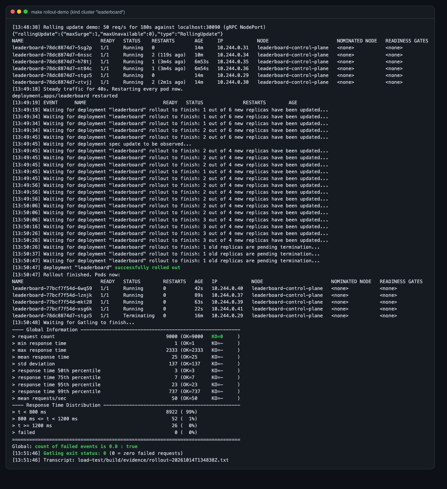

# Kubernetes

The service runs on Kubernetes with manifests in [`k8s/`](../k8s): plain YAML plus Kustomize. Locally it uses [kind](https://kind.sigs.k8s.io/) (Kubernetes in Docker). CI deploys the same manifests to a kind cluster on every push and calls the gRPC API ([`ci.yml`](../.github/workflows/ci.yml), job `kind-smoke`).

```
k8s/
├─ kind-config.yaml          one node; host ports 8081 (ingress) and 30090 (gRPC NodePort)
├─ base/                     what any environment gets
│  ├─ deployment.yaml        3 replicas, probes, preStop, RollingUpdate(maxUnavailable 0)
│  ├─ service.yaml           ClusterIP (8080 http, 9090 grpc) + headless service for gRPC
│  ├─ hpa.yaml               3–6 pods on 70% CPU
│  ├─ pdb.yaml               minAvailable 2
│  ├─ configmap.yaml / secret.yaml (example only)
│  ├─ postgres-statefulset.yaml, redis-deployment.yaml, ingress.yaml
│  └─ seed/                  one-shot data Job (separate so deploys don't re-run it)
└─ overlays/local/           kind: local image, IfNotPresent, gRPC NodePort 30090
```

## From zero

```bash
brew install kind kubectl                 # once
make kind-up        # cluster + metrics-server (for the HPA) + ingress-nginx
make deploy         # docker build, kind load, kubectl apply -k k8s/overlays/local
make seed-k8s       # 100k players, 500k events (~40 s)

grpcurl -plaintext -d '{"leaderboard":{"game_id":"fc-mobile","leaderboard_id":"season-1-high-score"},"n":3}' \
  localhost:30090 leaderboard.v1.LeaderboardService/GetTopN
open http://localhost:8081/demo            # REST, Swagger and the live page through ingress-nginx
make rollout-demo   # zero-downtime proof (below)
make kind-down
```

## How a rolling update stays zero-downtime

Each setting covers one way a deploy can drop requests:

| Risk | Setting | Where |
|---|---|---|
| Capacity dips while pods are swapped | `maxUnavailable: 0`, `maxSurge: 1`: a new pod must be **Ready** before an old one is removed | `deployment.yaml` |
| Traffic reaches a pod that is still warming up | `readinessProbe` → `/actuator/health/readiness`. The app only reports ready **after** `CacheWarmer` has loaded the boards into Redis, because Spring publishes readiness after the application runners | `deployment.yaml`, `CacheWarmer` |
| A slow JVM start gets killed by the liveness probe | `startupProbe` (up to 3 min) runs first; liveness only starts after it passes | `deployment.yaml` |
| A terminating pod still receives new connections | `preStop: sleep 10`. Removing a pod from Service endpoints is asynchronous, so the pod waits until kube-proxy and the ingress have stopped routing to it | `deployment.yaml` |
| In-flight requests are cut off | `server.shutdown=graceful` (HTTP), `grpc.server.shutdown-grace-period=20s` (gRPC finishes in-flight calls and sends **GOAWAY** so clients reconnect elsewhere), `spring.lifecycle.timeout-per-shutdown-phase=20s` | `application.yml` |
| Kubernetes kills the pod before draining finishes | `terminationGracePeriodSeconds: 45` (10 s preStop + up to 20 s drain + margin) | `deployment.yaml` |
| Node maintenance takes several pods at once | PodDisruptionBudget `minAvailable: 2` | `pdb.yaml` |

### The proof

`make rollout-demo` ([`scripts/rollout-demo.sh`](../scripts/rollout-demo.sh)) runs Gatling's `RollingUpdateSimulation` (50 req/s over gRPC, 80% GetTopN, 20% SubmitScore) for 3 minutes. After 40 s it runs `kubectl rollout restart deployment/leaderboard`, which replaces every pod. The Gatling assertion fails the run if a single request fails.

| Run | Pods replaced | Requests | Failed | p95 | p99 | Evidence |
|---|---|---|---|---|---|---|
| Final build | 6 (HPA had scaled up; it scaled down to 4 **during** the rollout) | 9,000 | **0** | 23 ms | 737 ms | [report](results/2026-10-14-rolling-update-kind-FINAL/index.html), [transcript](results/2026-10-14-rolling-update-kind-FINAL/rollout-transcript.txt) |
| Earlier build | 3 | 9,000 | **0** | 15 ms | 137 ms | [report](results/2026-10-14-rolling-update-kind/index.html), [transcript](results/2026-10-14-rolling-update-kind/rollout-transcript.txt) |



The cost shows up in the tail. The p99 rises while pods are swapped, because the client reconnects after each GOAWAY and new JVMs warm up, all on a single laptop node. But nothing fails.

## Autoscaling (HPA)

`hpa.yaml` keeps 3 to 6 pods at 70% of the CPU request. Under `MixedSimulation` at 400 req/s, CPU reached 131% of target and the HPA went **3 → 6 pods within ~15 s**, with 0 failed requests ([`kubectl get hpa -w` log](results/2026-10-14-hpa-scale-up-kind/kubectl-get-hpa-watch.txt), [report](results/2026-10-14-hpa-scale-up-kind/index.html)):

```
[13:37:57] leaderboard   Deployment/leaderboard   cpu: 11%/70%    3   6   3
[13:38:12] leaderboard   Deployment/leaderboard   cpu: 131%/70%   3   6   3
[13:38:27] leaderboard   Deployment/leaderboard   cpu: 132%/70%   3   6   6
...
[13:40:43] leaderboard   Deployment/leaderboard   cpu: 30%/70%    3   6   6
```

**What the HPA run also showed: gRPC load balancing.** Average CPU dropped once 6 pods existed, but latency didn't improve. Gatling sends everything over **one long-lived HTTP/2 connection**, and a Kubernetes Service balances per **connection** (L4), so all calls stayed on one pod while the new pods sat idle. With thousands of game clients, each holding its own connection, an L4 Service spreads load fine. For a few heavy callers (game servers, other services), you need per-request (L7) balancing:
- **Client-side:** `dns:///leaderboard-headless.leaderboard:9090` with the `round_robin` policy. The headless Service in `service.yaml` returns every pod IP.
- **Proxy:** an L7 proxy or service mesh (Envoy, Linkerd, Istio) that balances individual HTTP/2 streams.

(I tried simulating "one connection per client" from Gatling on the laptop. Opening a new connection per request through Docker Desktop's port forwarding saturated the machine, so that number isn't meaningful and isn't reported.)

## Problems found while getting it running (and the fixes)

| Symptom | Cause | Fix |
|---|---|---|
| Pods crash-looped: `Invalid endpoint, must start with http://` | `management.otlp.tracing.endpoint: ${OTLP_TRACING_ENDPOINT:}` became `""`, and an empty endpoint still creates an exporter. Tests didn't catch it because Spring Boot disables exporters in tests | Don't define the property at all unless set; compose sets `MANAGEMENT_OTLP_TRACING_ENDPOINT` |
| `Failed to bind spring.data.redis.port` | Kubernetes injected `REDIS_PORT=tcp://10.96.x.x:6379` for the Service named `redis` (legacy Docker-link env vars) | `enableServiceLinks: false`, plus an explicit `REDIS_PORT` |
| Seed Job never completed | `@Scheduled` threads keep the JVM alive after the seeder finished | `seed.exit-when-done` exits the JVM |
| 2 pods `OOMKilled` (exit 137) in a 700 req/s overload test | 768 MiB limit with a 75% heap left ~190 MiB for metaspace, JIT and Netty buffers, and nothing bounded in-flight reads | 1 GiB limit, 60% heap, and `maxConcurrentCallsPerConnection=256` so overload waits on the client side (HTTP/2 flow control) |

## Production notes (not done locally)

- **Managed data stores:** Postgres as RDS/Aurora/Cloud SQL (backups, replicas, failover) and Redis as ElastiCache/Memorystore with a replica. The app only needs `DB_URL` and `REDIS_HOST`.
- **Secrets:** External Secrets or Sealed Secrets instead of `secret.yaml`.
- **Several nodes and zones:** the `podAntiAffinity` (preferred) spreads pods across nodes; use topology spread constraints across zones.
- **gRPC via ingress:** needs TLS + HTTP/2 end to end (or a gRPC-aware gateway). Locally gRPC uses the NodePort.
- **Tracing:** 10% sampling (`TRACING_SAMPLING`) exported to a collector (OTel Collector → Tempo/Jaeger).
