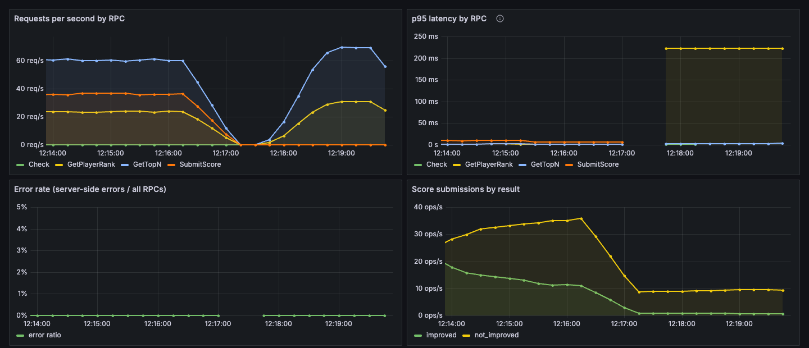
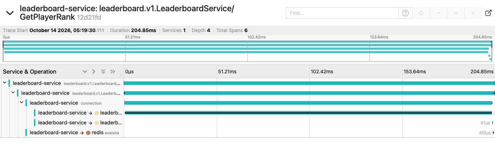

# Observability

The service is instrumented so you can answer "what is slow, and why?" without adding print statements. Each signal has its own job:

| Signal | Tool | Answers |
|---|---|---|
| **Metrics** | Micrometer → Prometheus → Grafana | *Is* something wrong, and where (which RPC, Redis or DB)? |
| **Traces** | OpenTelemetry → Jaeger | *Which step* of one slow request took the time? |
| **Logs** | Logback JSON with `traceId` | *What exactly* happened in that request? |

Local URLs after `make up`:
- Grafana: http://localhost:3000 (opens on the Leaderboard dashboard)
- Prometheus: http://localhost:9091
- Jaeger: http://localhost:16686
- Raw metrics: http://localhost:8080/actuator/prometheus

## Metrics

| Metric | Type | Why it exists |
|---|---|---|
| `leaderboard_query_seconds{rpc,status}` | timer + histogram | Latency and outcome of every gRPC call. The histogram lets Prometheus compute p95 across pods |
| `leaderboard_redis_seconds{operation}` / `leaderboard_db_seconds{operation}` | timer + histogram | Splits a slow RPC into "Redis was slow" vs "Postgres was slow" |
| `leaderboard_score_submissions_total{game,result}` | counter | `improved` / `not_improved` / `duplicate`. Duplicates show clients retrying |
| `leaderboard_optimistic_lock_retries_total` / `..._exhausted_total` | counter | Proves optimistic locking is resolving real conflicts, and alerts if it ever gives up |
| `leaderboard_redis_fallback_total{operation}` | counter | Reads served from Postgres because Redis failed |
| `resilience4j_circuitbreaker_state{name="redis"}` | gauge | Whether the Redis breaker is open |
| `leaderboard_drift_fixed_total` | counter | Scores the reconciler had to repair in Redis |
| `leaderboard_players{board}` | gauge | Players ranked on each current board |
| `leaderboard_submit_in_flight` / `_queued` / `leaderboard_submit_rejected_total` | gauge / counter | Bulkhead pressure during end-of-match bursts |
| `hikaricp_*`, `jvm_*`, `lettuce_*` | (built-in) | Connection pool, heap, GC, Redis client |

The [Grafana dashboard](../observability/grafana/dashboards/leaderboard.json) is provisioned automatically:


*Steady mixed traffic (top-100, my rank, submit). The spike on the left is the first ~30 s of traffic after the service sat idle (JIT and connection warm-up).*

### Alerts

[`observability/alerts.yml`](../observability/alerts.yml), loaded by Prometheus:

| Alert | Fires when | First panel to look at |
|---|---|---|
| `LeaderboardTopNSlow` | GetTopN p95 > 50 ms for 5 min | p95 latency by RPC → Redis / DB p95 |
| `LeaderboardHighErrorRate` | > 1% of RPCs fail with server errors for 5 min | Error rate, then logs by `traceId` |
| `LeaderboardRedisFallbackActive` | any Redis fallback for 1 min | Redis fallbacks & circuit breaker |
| `LeaderboardLockRetriesExhausted` | any write returned ABORTED in 5 min | Optimistic lock retries |

## Traces

Every gRPC call is a trace. Lettuce adds a span per Redis command, and datasource-micrometer adds spans for each JDBC connection and query. Here's a normal SubmitScore (3.25 ms):


Reading it top to bottom gives the write path:
1. Redis `GET` (idempotency check).
2. Redis `HMGET` (player exists?).
3. One Postgres connection holding the transaction: find event, find score, insert event, stats upsert, achievements, then the version-checked `UPDATE` at commit.
4. The Redis `EVALSHA` (Lua `ZADD GT` + rank), only after the commit.
5. Redis `SET` (remember the idempotency key).

Sampling: 100% locally so every request can be inspected. Kubernetes uses 10% (`TRACING_SAMPLING`); see [PERFORMANCE.md](PERFORMANCE.md#experiments-that-did-not-help-kept-for-honesty) for the measured cost. Background noise (the 250 ms live-update timer, Prometheus scrapes) is filtered out by an `ObservationPredicate`.

## Logs

The `json` profile (used by docker-compose and Kubernetes) writes one JSON object per line. MDC fields are `traceId`, `spanId`, `rpc`, `gameId` and `playerId`: ids only, no names or other personal data. Every RPC slower than 50 ms, or failing with a server error, is logged by `RpcMetricsInterceptor`:

```json
{"@timestamp":"2026-10-14T12:19:30.315Z","message":"rpc=GetPlayerRank status=OK latency_ms=204 description=null",
 "logger_name":"com.asmipahwa.leaderboard.grpc.interceptors.RpcMetricsInterceptor","level":"WARN",
 "gameId":"fc-mobile","traceId":"12d21fd9616f05849ed6bda6cb40d2fa","spanId":"9c8ba7ff1e33f363","rpc":"GetPlayerRank", ...}
```

## Debugging playbook: "p95 spiked, here's how I found it"

This walkthrough was **actually performed** on 2026-10-14 against the local stack. The fault was injected with the built-in switch `PUT /admin/faults/slow-rank-query?ms=200`, which runs a real `pg_sleep` inside Postgres on the GetPlayerRank path. The admin endpoint only exists when `ADMIN_ENDPOINTS=true`, and that's set in docker-compose only.

```bash
curl -X PUT "localhost:8080/admin/faults/slow-rank-query?ms=200"     # break it
./gradlew :load-test:gatlingRun-com.asmipahwa.leaderboard.load.ReadHeavySimulation \
    -Prate=100 -Pduration=90 -PrankShare=30 -Pwarmup=0                # traffic
```

**Step 1: Metrics say *where*.** In the "p95 latency by RPC" panel, GetPlayerRank jumps to about 220 ms while GetTopN stays flat. So it's one RPC, not the whole service, not Redis-wide and not the JVM.



The same answer from Prometheus directly:
```
histogram_quantile(0.95, sum by (le, rpc) (rate(leaderboard_query_seconds_bucket[1m])))
  GetTopN        3.1 ms
  GetPlayerRank  222.6 ms
```

**Step 2: A trace says *which step*.** In Jaeger: service `leaderboard-service`, operation `GetPlayerRank`, min duration `100ms`. Almost the whole 204.85 ms request is one JDBC span, while the Redis `evalsha` that does the real work takes 0.45 ms:



```
 204.8 ms  leaderboard.v1.LeaderboardService/GetPlayerRank
 203.1 ms  connection
 202.6 ms  query   SELECT pg_sleep(?) IS NULL
```

**Step 3: Logs give *context*.** Search the logs for the trace id (`docker compose logs app | grep 12d21fd9616f05849ed6bda6cb40d2fa`). You get the slow-call line above with `gameId` and `rpc`. In a real incident, this is where you'd find the player, the input, and any warnings.

**Step 4: Fix and confirm.** `PUT /admin/faults/slow-rank-query?ms=0` and the GetPlayerRank p95 line returns to about 1–3 ms.

**What I'd do in a real incident:** an unexpected SQL query on a Redis-backed read path usually means the cache isn't being used (a missing/expired board leading to a rebuild, or the breaker sending reads to the Postgres fallback). So next I'd check `leaderboard_redis_fallback_total` and the breaker panel. Here they were flat, which pointed at the code path itself.
